# Orders API — Serverless REST API con AWS Lambda y API Gateway

API REST de gestión de órdenes construida con **Java 17**, **Maven**, **AWS Lambda** y **Amazon API Gateway**.

El objetivo del taller no es solo obtener endpoints funcionando, sino analizar **dónde debe vivir cada responsabilidad**: en API Gateway, en el adaptador Lambda/HTTP o en la lógica de aplicación.
 
---

## Tabla de contenido

1. [Diseño de la API](#1-diseño-de-la-api)
2. [Parte I — Aplicación en Java puro](#2-parte-i--aplicación-en-java-puro)
3. [Parte II — Despliegue en AWS Lambda](#3-parte-ii--despliegue-en-aws-lambda)
4. [Parte III y IV — API Gateway con mapping templates](#4-parte-iii-y-iv--api-gateway-con-mapping-templates)
5. [Parte V — Lambda proxy integration](#5-parte-v--lambda-proxy-integration)
6. [Comparación de arquitecturas](#6-comparación-de-arquitecturas)
7. [Desarrollo asistido por IA](#7-desarrollo-asistido-por-ia)
8. [Extensión: DELETE /orders/{id}](#8-extensión-delete-ordersid)
9. [Arquitectura final](#9-arquitectura-final)
10. [Cómo compilar y probar](#10-cómo-compilar-y-probar)
---

## 1. Diseño de la API

### Modelo

```json
{
  "id": "ORD-001",
  "customerId": "CUST-42",
  "product": "MacBook Air",
  "quantity": 1
}
```

### Contrato

| Operación | Método y URL | Path params | Query params | Body de entrada | Éxito | Errores |
|---|---|---|---|---|---|---|
| Crear orden | `POST /orders` | — | — | `{customerId, product, quantity}` | **201 Created** + header `Location: /orders/{id}` + orden creada | **400** datos inválidos |
| Obtener orden | `GET /orders/{id}` | `id` | — | — | **200 OK** + orden | **404** no existe |
| Buscar por cliente | `GET /orders?customerId={customerId}` | — | `customerId` (obligatorio) | — | **200 OK** + lista de órdenes (puede ser `[]`) | **400** falta `customerId` |
| Eliminar orden | `DELETE /orders/{id}` | `id` | — | — | **204 No Content** (sin body) | **404** no existe |
| Cualquiera | — | — | — | — | — | **500** error inesperado |

### Formato de error

Todas las respuestas de error usan la misma estructura:

```json
{
  "error": "ORDER_NOT_FOUND",
  "message": "Order ORD-999 does not exist"
}
```

| Código `error` | HTTP | Cuándo |
|---|---|---|
| `INVALID_REQUEST` | 400 | Falta un campo obligatorio, `quantity <= 0`, body mal formado o falta `customerId` en la búsqueda |
| `ORDER_NOT_FOUND` | 404 | El `id` solicitado no existe |
| `INTERNAL_ERROR` | 500 | Cualquier error no previsto (sin exponer detalles internos) |

### Preguntas de diseño

**¿Cuáles son los recursos de la API?**
Hay un recurso principal, la orden, expuesto de dos formas: la **colección** de órdenes (`/orders`) y cada **orden individual** (`/orders/{id}`). Las operaciones se expresan con métodos HTTP sobre esos recursos, no con verbos en la URL (no existe `/createOrder` ni `/getOrder`).

**¿Por qué `/orders/{id}` para obtener una orden?**
Porque el `id` identifica de forma única a un recurso. La ruta se lee como "la orden `{id}` dentro de la colección de órdenes", y esa misma URL sirve para operar sobre ese recurso con otros métodos (`DELETE /orders/{id}`). Además, es la URL que se devuelve en el header `Location` al crear una orden.

**¿Por qué `customerId` es un query parameter en la búsqueda?**
Porque no identifica un recurso nuevo: **filtra** la colección `/orders`. El resultado sigue siendo una colección de órdenes. Los query parameters son la forma natural de expresar criterios de filtrado opcionales o combinables (por ejemplo, en el futuro `?customerId=CUST-42&product=Mouse`). Una ruta como `/customers/{id}/orders` también sería válida, pero implicaría modelar al cliente como recurso, lo cual no es necesario en este alcance.

**¿Qué debe devolver `POST /orders` cuando la orden se crea correctamente?**
`201 Created`, el body con la orden creada (incluyendo el `id` generado por el servidor) y el header `Location: /orders/{id}` indicando dónde quedó el nuevo recurso.

**¿Qué debe devolver la API cuando una orden no existe?**
`404 Not Found` con el JSON de error (`ORDER_NOT_FOUND`) y un mensaje que indique qué `id` no se encontró. No se debe responder `200` con body vacío ni `null`, porque el cliente no podría distinguir el error usando HTTP.

**¿Qué información debe contener una respuesta de error?**
- Un **código estable** (`error`) que un programa cliente pueda interpretar sin depender del texto.
- Un **mensaje legible** (`message`) para humanos que explique el problema.
- **No** debe contener stack traces, nombres de clases ni detalles internos de la infraestructura.
### Nota sobre persistencia

No se usa base de datos. Las órdenes se guardan en una colección en memoria (`InMemoryOrderRepository`), precargada con datos de ejemplo:

| id | customerId | product | quantity |
|---|---|---|---|
| ORD-001 | CUST-42 | MacBook Air | 1 |
| ORD-002 | CUST-42 | Mouse | 2 |
| ORD-003 | CUST-7 | Keyboard | 2 |

Los entornos de ejecución de Lambda son **efímeros**: la memoria se pierde cuando AWS recicla el entorno, y cada función Lambda tiene su propia memoria. Por eso una orden creada con `POST` puede no ser visible desde la Lambda que atiende `GET`. Los datos precargados permiten demostrar el comportamiento de lectura de forma predecible. En un sistema real, el repositorio en memoria se reemplazaría por una implementación persistente (por ejemplo DynamoDB) sin cambiar `OrderService`.
 
---

## 2. Parte I — Aplicación en Java puro

### Estructura

```
orders-api/
├── pom.xml
├── README.md
└── src/
    ├── main/java/com/workshop/orders/
    │   ├── domain/
    │   │   ├── Order.java
    │   │   ├── CreateOrderRequest.java
    │   │   ├── OrderNotFoundException.java
    │   │   └── InvalidOrderException.java
    │   └── application/
    │       ├── OrderRepository.java
    │       ├── InMemoryOrderRepository.java
    │       └── OrderService.java
    └── test/java/com/workshop/orders/application/
        └── OrderServiceTest.java
```

### Responsabilidades

| Clase | Responsabilidad |
|---|---|
| `Order`, `CreateOrderRequest` | Representan los conceptos del negocio |
| `OrderNotFoundException`, `InvalidOrderException` | Expresan fallos **de negocio** ("la orden no existe", "datos inválidos"), no códigos HTTP |
| `OrderRepository` | Abstracción del almacenamiento |
| `InMemoryOrderRepository` | Implementación en memoria del almacenamiento |
| `OrderService` | Reglas de negocio: validación, generación de ids, creación, consulta y búsqueda |

### Decisiones de diseño

- **La validación vive en `OrderService`.** Que una orden necesite cliente, producto y cantidad positiva es una regla de negocio: debe cumplirse sin importar si la petición llega por HTTP, por una invocación directa de Lambda o desde un test.
- **Los errores se modelan con excepciones de dominio.** La traducción a `400` o `404` es responsabilidad de una capa externa (API Gateway o el adaptador HTTP), no de la lógica de negocio.
- **Repositorio detrás de una interfaz.** Permite cambiar el almacenamiento en memoria por uno persistente sin tocar `OrderService`, y facilita las pruebas.
- **POJOs clásicos** (constructor vacío + getters/setters) en lugar de `record`, para que el serializador del runtime de Lambda pueda convertirlos desde y hacia JSON sin configuración adicional.
### Pruebas

`OrderServiceTest` cubre:

- creación de una orden válida;
- consulta de una orden existente;
- consulta de una orden inexistente (`OrderNotFoundException`);
- búsqueda de órdenes por cliente;
- búsqueda de un cliente sin órdenes (lista vacía);
- entradas inválidas: `customerId` nulo, `product` vacío, `quantity` en 0, request nulo y `customerId` vacío en la búsqueda.
  Resultado de `mvn test`:

```
Tests run: 10, Failures: 0, Errors: 0, Skipped: 0
BUILD SUCCESS
```

### Checkpoint 1

**¿Se puede probar la funcionalidad sin AWS?**
Sí. `mvn test` ejecuta todas las pruebas localmente, sin credenciales ni servicios de AWS.

**¿La aplicación requiere un servidor web?**
No. Es un conjunto de clases Java que se invocan directamente.

**¿Requiere Spring Boot?**
No. La única dependencia del proyecto es JUnit 5, y solo en `scope` de test.

**¿Qué contiene el JAR generado?**
Únicamente las clases compiladas del proyecto y los metadatos de Maven (`jar tf target/orders-api-1.0.0.jar`):

```
META-INF/MANIFEST.MF
com/workshop/orders/application/InMemoryOrderRepository.class
com/workshop/orders/application/OrderRepository.class
com/workshop/orders/application/OrderService.class
com/workshop/orders/domain/CreateOrderRequest.class
com/workshop/orders/domain/InvalidOrderException.class
com/workshop/orders/domain/Order.class
com/workshop/orders/domain/OrderNotFoundException.class
META-INF/maven/com.workshop/orders-api/pom.xml
META-INF/maven/com.workshop/orders-api/pom.properties
```

No incluye JUnit (dependencia de test), ni librerías de AWS, ni servidor web.

**¿Qué partes de la aplicación conocen HTTP?**
Ninguna. En este punto no existe ningún concepto de request, response, header ni status code en el código.
 
---

## 3. Parte II — Despliegue en AWS Lambda

### Función desplegada

Se desplegó la operación **crear orden** como la función Lambda `orders-create`.

| Configuración | Valor |
|---|---|
| Runtime | Java 17 |
| Arquitectura | x86_64 |
| Rol de ejecución | `LabRole` |
| Artefacto | `target/orders-api-1.0.0.jar` |
| Handler | `com.workshop.orders.lambda.CreateOrderFunction::handleRequest` |

No fue necesario rediseñar la aplicación. Se agregó una única clase de entrada, `CreateOrderFunction`, que construye el `OrderService` y le delega la operación:

```java
public class CreateOrderFunction {
 
    private static final OrderService SERVICE =
            new OrderService(InMemoryOrderRepository.withSampleData());
 
    public Order handleRequest(CreateOrderRequest request) {
        return SERVICE.createOrder(request);
    }
}
```

Esta clase **no depende de ninguna librería de AWS**: recibe un `CreateOrderRequest` y devuelve un `Order`. Existe solo porque el runtime de Lambda necesita instanciar la clase del handler con un constructor vacío, y `OrderService` recibe su repositorio por constructor. El JAR sigue sin dependencias externas, por lo que se sube tal cual.

### Invocaciones manuales

#### 1. Orden válida

**Request**
```json
{ "customerId": "CUST-42", "product": "MacBook Air", "quantity": 1 }
```

**Response**
```json
{ "id": "ORD-004", "customerId": "CUST-42", "product": "MacBook Air", "quantity": 1 }
```

El id es `ORD-004` porque el repositorio arranca con tres órdenes precargadas. Esta primera invocación mostró `Init duration: 308.90 ms`, que corresponde al *cold start*: el tiempo que tarda AWS en crear el entorno de ejecución y cargar la clase.

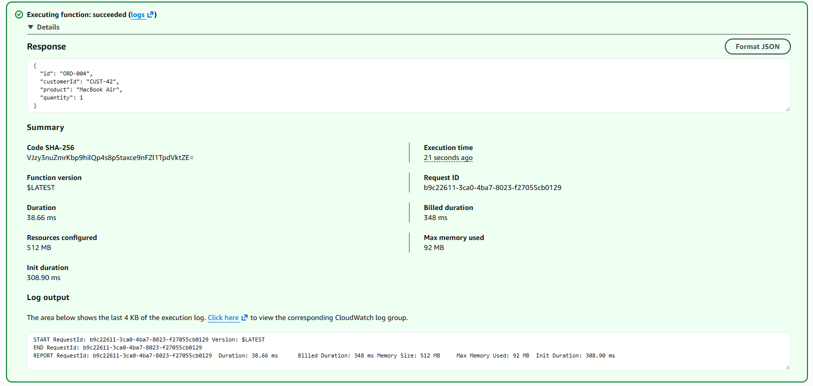

#### 2. Invocaciones repetidas: el id se incrementa

Al repetir la misma invocación, el id avanza (`ORD-005`, `ORD-006`, …) y ya no aparece `Init duration`. Además, la duración cae de **38.66 ms** en la primera invocación a **1.71 ms** en una invocación caliente.

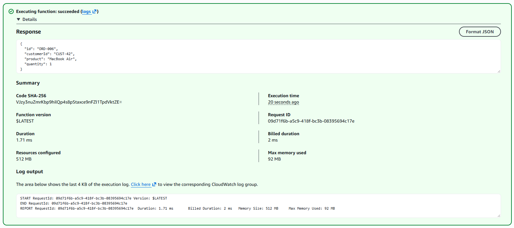

Esto demuestra que, mientras el entorno está "caliente", Lambda **reutiliza** la misma instancia y por lo tanto los campos `static` (el `OrderService` y su repositorio en memoria) sobreviven entre invocaciones. Cuando AWS recicla el entorno, el estado se pierde y el contador vuelve a empezar. La memoria de Lambda sirve como caché, **no como almacenamiento persistente**.

#### 3. Otro cliente

**Request**
```json
{ "customerId": "CUST-100", "product": "Monitor", "quantity": 3 }
```

Respuesta exitosa con una nueva orden para `CUST-100`.

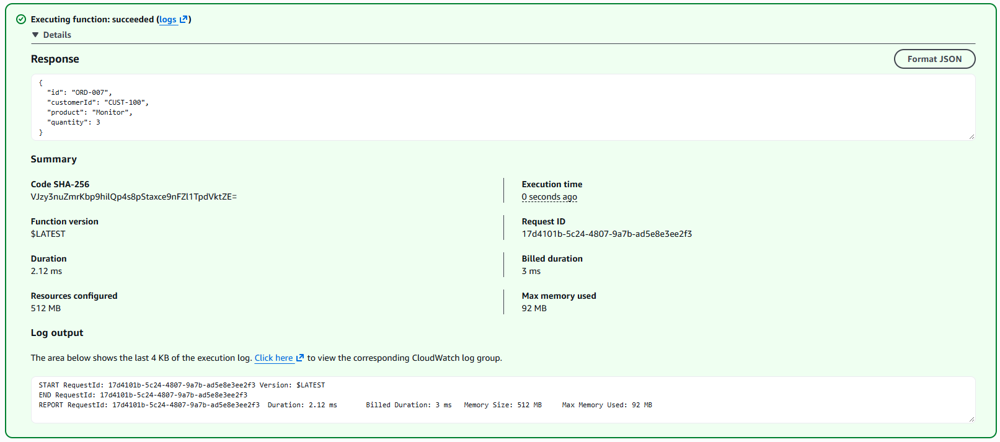

#### 4. Cantidad en cero → falla en la lógica de negocio

**Request**
```json
{ "customerId": "CUST-42", "product": "Mouse", "quantity": 0 }
```

La invocación **falla**. El JSON se convirtió correctamente a `CreateOrderRequest` y el código llegó a `OrderService`, que lanzó `InvalidOrderException`. El runtime transformó la excepción en este JSON:

```json
{
  "errorMessage": "quantity must be greater than 0",
  "errorType": "com.workshop.orders.domain.InvalidOrderException",
  "stackTrace": [
    "com.workshop.orders.application.OrderService.validate(OrderService.java:50)",
    "com.workshop.orders.application.OrderService.createOrder(OrderService.java:15)",
    "com.workshop.orders.lambda.CreateOrderFunction.handleRequest(CreateOrderFunction.java:15)",
    "..."
  ]
}
```

El `stackTrace` muestra la ruta completa a través de **nuestro** código: `CreateOrderFunction` → `OrderService.createOrder` → `OrderService.validate`.

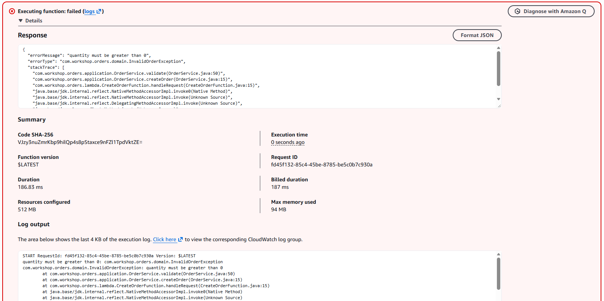

#### 5. Cantidad como texto → falla en el runtime, antes de llegar al código

**Request**
```json
{ "customerId": "CUST-42", "product": "Mouse", "quantity": "dos" }
```

La invocación **falla**, pero por una razón distinta. La respuesta fue:

```json
{
  "errorMessage": "An error occurred during JSON parsing",
  "errorType": "java.lang.RuntimeException",
  "stackTrace": []
}
```

Y en el log de CloudWatch aparece la causa real:

```
Caused by: com.amazonaws.lambda.thirdparty.com.fasterxml.jackson.databind.exc.InvalidFormatException:
Cannot deserialize value of type `java.lang.Integer` from String "dos": not a valid `java.lang.Integer` value
 (through reference chain: com.workshop.orders.domain.CreateOrderRequest["quantity"])
    at com.amazonaws.services.lambda.runtime.serialization.factories.JacksonFactory$InternalSerializer.fromJson(...)
```

Observaciones:

- El `stackTrace` de la respuesta está **vacío** y no aparece ninguna clase de nuestro paquete: el error ocurrió **antes** de ejecutar `handleRequest`. Ninguna línea de la aplicación se ejecutó.
- El `errorType` es un genérico `java.lang.RuntimeException`, no una excepción nuestra. El cliente no puede saber qué campo estaba mal sin revisar los logs.
- La causa revela la librería que usa el runtime: **Jackson**, empaquetado internamente por AWS (`com.amazonaws.lambda.thirdparty.com.fasterxml.jackson`), invocado desde `JacksonFactory`.
- Es un error de **formato** del mensaje, no de una regla de negocio.
  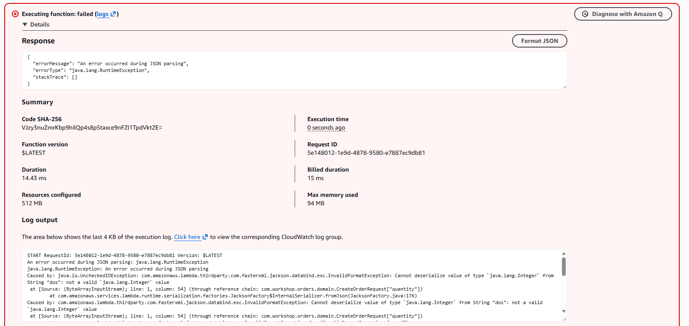

#### 6. Campo desconocido → se ignora

**Request**
```json
{ "customerId": "CUST-42", "product": "Mouse", "quantity": 1, "color": "rojo" }
```

La invocación **tiene éxito** y devuelve `ORD-008` sin el campo `color`. `CreateOrderRequest` no tiene ese campo, y el serializador del runtime simplemente lo ignoró.

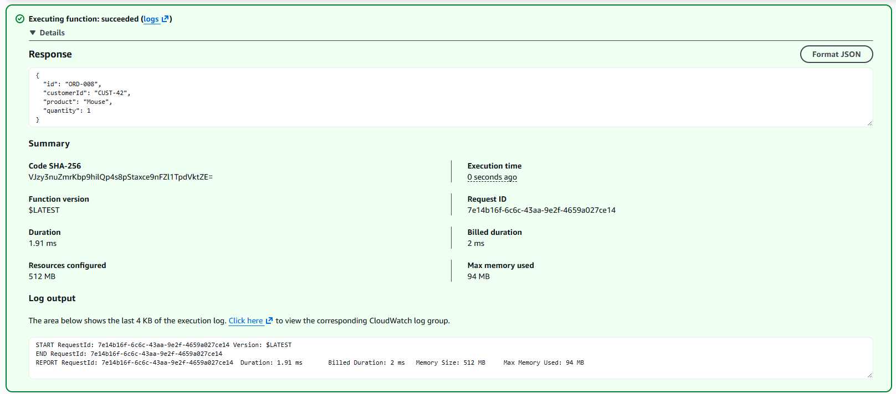

### Investigación: ¿cómo convierte el runtime de Lambda JSON ↔ Java?

**Explicación propuesta (con ayuda del LLM):**

1. Al crear el entorno, el runtime lee el handler configurado (`Clase::metodo`), carga la clase desde el JAR y la instancia con su **constructor vacío**.
2. Por **reflexión**, inspecciona el tipo del parámetro del método (`CreateOrderRequest`).
3. Usa un serializador JSON interno, basado en Jackson, para crear ese objeto: instancia la clase con el constructor vacío y asigna cada campo del JSON mediante el **setter** del mismo nombre.
4. Ejecuta el método.
5. Serializa el valor de retorno (`Order`) a JSON usando sus **getters**.
6. Si el método lanza una excepción, la convierte en un JSON con `errorMessage`, `errorType` y `stackTrace`, y marca la invocación como fallida.
7. Además de POJOs, el método puede recibir `String`, `Map` o un `InputStream` crudo (implementando `RequestStreamHandler`) cuando se quiere controlar la serialización manualmente.
   **Verificación contra el comportamiento observado:**

| Afirmación | Evidencia | ¿Se cumple? |
|---|---|---|
| El serializador interno está basado en Jackson | Prueba 5: el log muestra `com.amazonaws.lambda.thirdparty.com.fasterxml.jackson` y `JacksonFactory` | ✅ |
| JSON → POJO por nombre de campo | Prueba 1: los tres campos llegaron correctamente a `CreateOrderRequest`; prueba 5: el error referencia `CreateOrderRequest["quantity"]` | ✅ |
| POJO → JSON con getters | Prueba 1: la respuesta contiene `id`, `customerId`, `product`, `quantity` | ✅ |
| La instancia se reutiliza entre invocaciones calientes | Prueba 2: el id se incrementa y desaparece el `Init duration` | ✅ |
| Las excepciones de la aplicación se convierten en JSON de error | Prueba 4: `errorType` es nuestra `InvalidOrderException` | ✅ |
| Un JSON incompatible con el tipo falla antes de ejecutar el código | Prueba 5: el error viene del parseo, no de `OrderService` | ✅ |
| Las propiedades desconocidas se ignoran | Prueba 6: `color` no produjo error | ✅ |

**Conclusión:** la conversión JSON ↔ Java es responsabilidad del **runtime de Lambda**, no de nuestro código. Por eso la aplicación puede trabajar solo con objetos de dominio. La contrapartida es que perdemos control sobre los errores de formato (prueba 5) y que todas las fallas se reportan con el mismo formato genérico de Lambda, no con el formato de error que diseñamos para la API. Ese problema se resolverá cuando agreguemos la capa HTTP.

### Checkpoint 2 — Diagrama de la solución

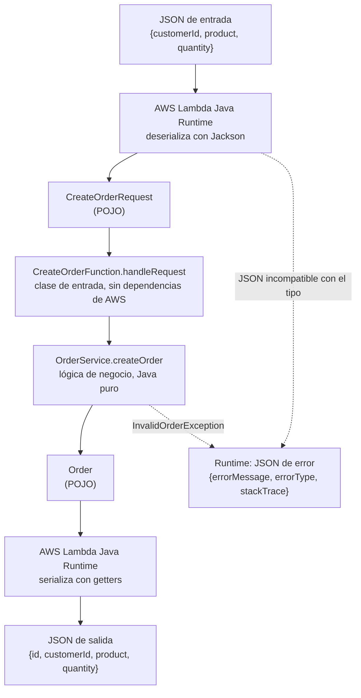

## 4. Parte III y IV — API Gateway con mapping templates

En esta arquitectura (**Arquitectura A**), API Gateway usa **integración Lambda no-proxy**: transforma cada request HTTP en el JSON exacto que espera cada función Java y transforma cada respuesta (o error) de Lambda en una respuesta HTTP.

### Arquitectura

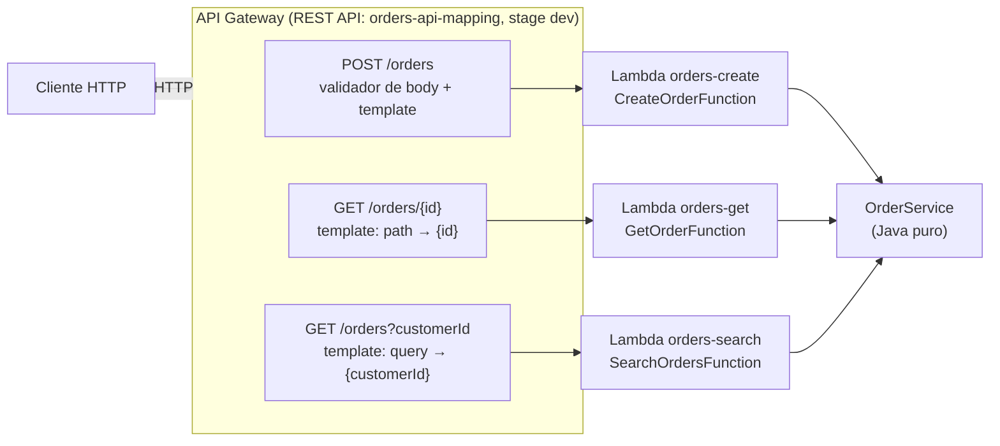

### Decisiones de diseño

**Una Lambda por operación.** Las tres funciones usan el mismo JAR con distinto handler. Así, el enrutamiento queda completamente en API Gateway, que es la idea de esta arquitectura.

| Función | Handler | Recurso |
|---|---|---|
| `orders-create` | `com.workshop.orders.lambda.CreateOrderFunction::handleRequest` | `POST /orders` |
| `orders-get` | `com.workshop.orders.lambda.GetOrderFunction::handleRequest` | `GET /orders/{id}` |
| `orders-search` | `com.workshop.orders.lambda.SearchOrdersFunction::handleRequest` | `GET /orders?customerId=` |

**Traducción de errores con prefijos estables.** En integración no-proxy, API Gateway solo puede elegir el status code comparando el `errorMessage` de Lambda contra expresiones regulares. Para no depender de frases en inglés, la capa `lambda` traduce las excepciones de dominio a mensajes con un prefijo:

| Excepción de dominio | `errorMessage` | Regex en API Gateway | Status |
|---|---|---|---|
| `OrderNotFoundException` | `ORDER_NOT_FOUND: Order ORD-999 does not exist` | `ORDER_NOT_FOUND:.*` | 404 |
| `InvalidOrderException` | `INVALID_REQUEST: quantity must be greater than 0` | `INVALID_REQUEST:.*` | 400 |
| Cualquier otra | `INTERNAL_ERROR: Unexpected error` | `INTERNAL_ERROR:.*` | 500 |

El dominio sigue sin conocer HTTP: la traducción está en `LambdaErrors` (paquete `lambda`) y la decisión del status code la toma API Gateway. Esta traducción tiene pruebas unitarias en `LambdaFunctionsTest`, que se ejecutan sin AWS.

**Validación dividida entre formato y negocio.**
- **API Gateway** valida el **formato** del body de `POST /orders` con un modelo JSON Schema (`CreateOrderRequest`) y el validador `Validate body`: que `quantity` sea entero y que los textos sean texto.
- **`OrderService`** valida las **reglas de negocio**: campos obligatorios no vacíos y `quantity ≥ 1`.
  Cada regla vive en un solo lugar.

### Configuración de API Gateway

#### `GET /orders/{id}`

**Integration request** — mapping template (`application/json`):
```
{
  "id": "$util.escapeJavaScript($input.params('id'))"
}
```

**Integration responses:**

| Regex | Status |
|---|---|
| _(default)_ | 200 |
| `ORDER_NOT_FOUND:.*` | 404 |
| `INVALID_REQUEST:.*` | 400 |
| `INTERNAL_ERROR:.*` | 500 |

Plantilla de error (cambiando `"error"` según el caso):
```
#set($full = $input.path('$.errorMessage'))
#set($start = $full.indexOf(': ') + 2)
{
  "error": "ORDER_NOT_FOUND",
  "message": "$util.escapeJavaScript($full.substring($start))"
}
```

#### `GET /orders?customerId={customerId}`

**Method request:** query string `customerId` (no requerido; la validación la hace `OrderService`).

**Integration request** — mapping template:
```
{
  "customerId": "$util.escapeJavaScript($input.params('customerId'))"
}
```

**Integration responses:** default → 200, `INVALID_REQUEST:.*` → 400, `INTERNAL_ERROR:.*` → 500 (misma plantilla de error).

#### `POST /orders`

**Model `CreateOrderRequest`:**
```json
{
  "$schema": "http://json-schema.org/draft-04/schema#",
  "title": "CreateOrderRequest",
  "type": "object",
  "properties": {
    "customerId": { "type": "string" },
    "product":    { "type": "string" },
    "quantity":   { "type": "integer", "maximum": 2147483647 }
  }
}
```

**Method request:** validador `Validate body` con el modelo `CreateOrderRequest`.

**Integration request** — mapping template:
```
$input.json('$')
```

**Integration response por defecto → 201**, con el header `Location` construido en VTL:
```
#set($id = $input.path('$.id'))
#set($context.responseOverride.header.Location = "/orders/$id")
$input.json('$')
```

**Integration responses de error:** `INVALID_REQUEST:.*` → 400, `INTERNAL_ERROR:.*` → 500.

**Gateway response `Bad Request Body`** (cuando falla el validador):
```
{
  "error": "INVALID_REQUEST",
  "message": "$util.escapeJavaScript($context.error.validationErrorString)"
}
```

### Pruebas con curl

```powershell
$API = "https://yafdh47yu9.execute-api.us-east-1.amazonaws.com/dev"
```

| Request | Status | Body |
|---|---|---|
| `GET /orders/ORD-001` | **200 OK** | `{"id":"ORD-001","customerId":"CUST-42","product":"MacBook Air","quantity":1}` |
| `GET /orders/ORD-999` | **404 Not Found** | `{"error":"ORDER_NOT_FOUND","message":"Order ORD-999 does not exist"}` |
| `GET /orders?customerId=CUST-42` | **200 OK** | `[{"id":"ORD-001",...},{"id":"ORD-002",...}]` |
| `GET /orders?customerId=CUST-100` | **200 OK** | `[]` |
| `GET /orders` | **400 Bad Request** | `{"error":"INVALID_REQUEST","message":"customerId is required"}` |
| `POST /orders` (válido) | **201 Created** + `Location: /orders/ORD-004` | `{"id":"ORD-004","customerId":"CUST-42","product":"MacBook Air","quantity":1}` |
| `POST /orders` (`quantity: 0`) | **400 Bad Request** | `{"error":"INVALID_REQUEST","message":"quantity must be greater than 0"}` |
| `POST /orders` (`quantity: "dos"`) | **400 Bad Request** | `{"error":"INVALID_REQUEST","message":"([instance type (string) does not match any allowed primitive type (allowed: [\"integer\"])])"}` |
| `GET /orders/ORD-004` (recién creada) | **404 Not Found** | `{"error":"ORDER_NOT_FOUND","message":"Order ORD-004 does not exist"}` |

Los bodies de los POST están en la carpeta [`requests/`](requests/).

#### Evidencias

`GET /orders/{id}` — orden existente (200):

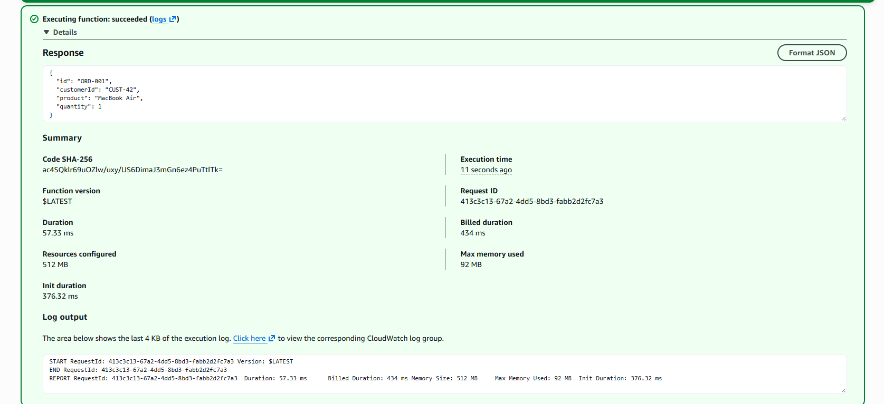

`GET /orders/{id}` — orden inexistente (404):

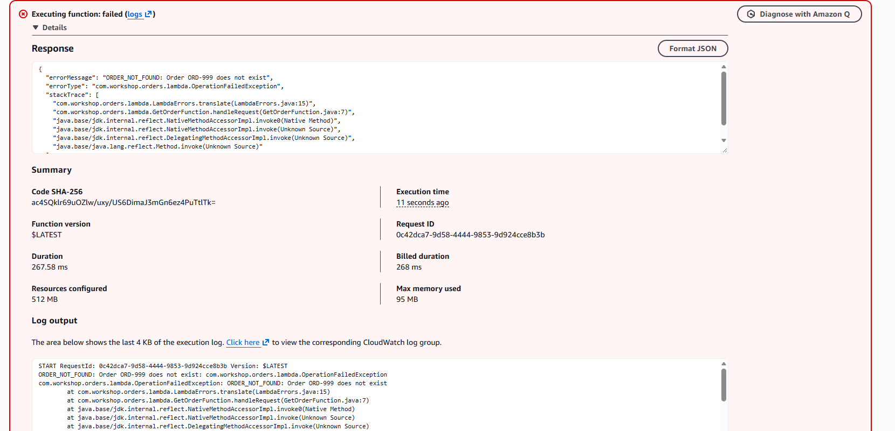

Mapping de respuesta — caso válido:

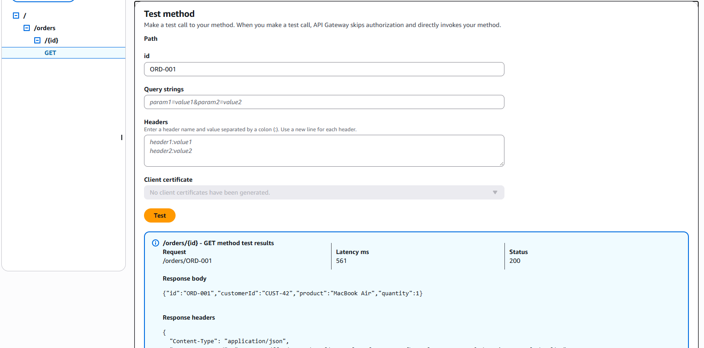

Mapping de respuesta — `ORDER_NOT_FOUND` convertido al formato de error del contrato:

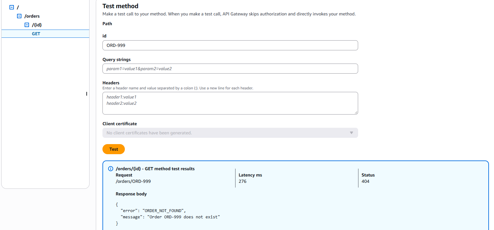

`POST /orders` con `"quantity": "dos"` **antes** de la corrección: 201 con el error crudo de Lambda (ver hallazgo 1):

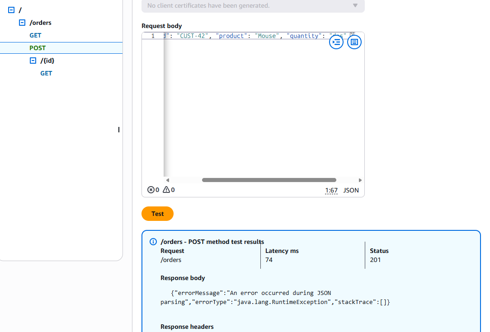

`POST /orders` con `"quantity": "dos"` **después** de agregar el validador de modelo: 400 en 4 ms, sin invocar Lambda:

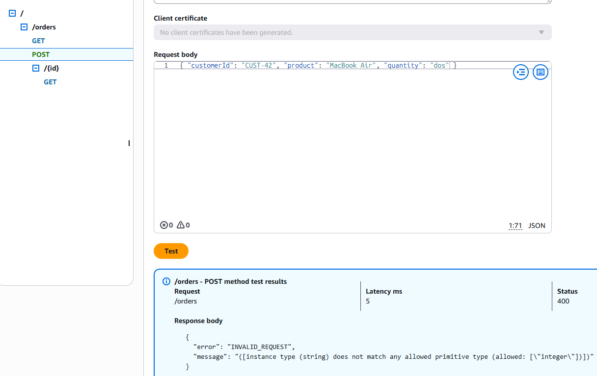

`GET /orders` sin `customerId` **después** de agregar el mapeo de errores al método: 400 con el formato del contrato, sin exponer el stack trace (ver hallazgo 3):

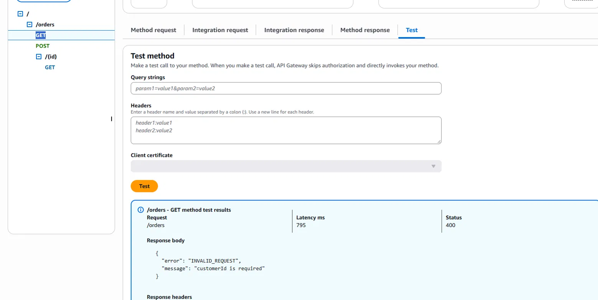

Comandos:
```powershell
curl.exe -i "$API/orders/ORD-001"
curl.exe -i "$API/orders/ORD-999"
curl.exe -i "$API/orders?customerId=CUST-42"
curl.exe -i "$API/orders?customerId=CUST-100"
curl.exe -i "$API/orders"
curl.exe -i -X POST "$API/orders" -H "Content-Type: application/json" --data-binary "@requests/create-order.json"
curl.exe -i -X POST "$API/orders" -H "Content-Type: application/json" --data-binary "@requests/create-order-invalid-quantity.json"
curl.exe -i -X POST "$API/orders" -H "Content-Type: application/json" --data-binary "@requests/create-order-text-quantity.json"
curl.exe -i "$API/orders/ORD-004"
```

### Hallazgos durante la implementación

**1. Un error sin regex que coincida se convierte en un éxito.**
Antes de configurar el validador, `POST /orders` con `"quantity": "dos"` respondió **201 Created** con este body:
```json
{"errorMessage":"An error occurred during JSON parsing","errorType":"java.lang.RuntimeException","stackTrace":[]}
```
El runtime de Lambda falló al deserializar el body, **antes** de ejecutar nuestro código, así que el mensaje no tenía prefijo. Ninguna regex coincidió y API Gateway usó la respuesta por defecto (201). Incluso ejecutó la plantilla del `Location` sobre el error, y produjo el header roto `Location: /orders/`. Los logs de API Gateway lo confirmaron:
```
Endpoint response headers: {... X-Amz-Function-Error=Unhandled ...}
Endpoint response body before transformations: {"errorMessage":"An error occurred during JSON parsing",...}
Response header overrides: Add Location: /orders/
Method completed with status: 201
```

**2. Una sola regex por status code.**
El primer intento de solución fue agregar otra integration response para el 400, pero API Gateway solo admite **una** por status code. Habría sido necesario combinar patrones (`A|B`) y agregar lógica condicional en VTL, dependiendo además del texto exacto de un mensaje interno de AWS. Se descartó esa opción en favor del validador de modelos, que frena el request **antes** de invocar Lambda: la latencia bajó a **4 ms** y en los logs ya no aparece la llamada a Lambda.

**3. Un método sin mapeo de errores filtra detalles internos.**
Mientras `GET /orders` no tenía integration responses de error, `GET /orders` sin `customerId` respondió **200 OK** con el error crudo de Lambda, incluyendo el `stackTrace` con nombres de clases y números de línea:
```json
{"errorMessage":"INVALID_REQUEST: customerId is required","errorType":"com.workshop.orders.lambda.OperationFailedException","stackTrace":["com.workshop.orders.lambda.LambdaErrors.translate(LambdaErrors.java:17)", ...]}
```
El código Java era correcto. El problema era **configuración faltante** en un método, y nada en la configuración lo advertía.

**4. Errores de tipeo sin red de seguridad.**
En una plantilla de error se escribió `"INTERNAL_REQUEST"` en lugar de `"INTERNAL_ERROR"`. En Java, un test lo habría detectado. En una mapping template, nada lo detecta hasta que ocurre un error 500 en producción.

**5. Lo que se crea en una Lambda no existe en las demás.**
`POST /orders` respondió **201** con `Location: /orders/ORD-004`, pero `GET /orders/ORD-004` respondió **404**. De igual forma, `CUST-100` aparece vacío aunque se le creó una orden en la Parte II. Cada Lambda (`orders-create`, `orders-get`, `orders-search`) tiene su propio entorno de ejecución y su propia copia del repositorio en memoria. Con una base de datos compartida (por ejemplo DynamoDB) bastaría con otra implementación de `OrderRepository`, sin modificar `OrderService`.

### Checkpoint 3 — Responsabilidades de API Gateway

En esta arquitectura, API Gateway es responsable de:

| Responsabilidad | Cómo se implementó |
|---|---|
| **Enrutamiento** | Recursos `/orders` y `/orders/{id}` con un método por operación, cada uno conectado a una Lambda distinta |
| **Extracción de path parameters** | `$input.params('id')` en la mapping template |
| **Extracción de query parameters** | `$input.params('customerId')` en la mapping template |
| **Transformación de requests** | Mapping templates que construyen el JSON de entrada de cada función |
| **Validación de formato** | Modelo JSON Schema + validador `Validate body` |
| **Transformación de respuestas** | Plantilla del 201 que devuelve la orden; plantillas que convierten el error de Lambda al formato `{error, message}` |
| **Elección de status codes** | 201 por defecto en POST; 404/400/500 por regex sobre `errorMessage` |
| **Headers de respuesta** | `Location` construido en VTL con `$context.responseOverride` |
| **Mapeo de errores** | Una regex por status code en cada método; Gateway response `Bad Request Body` para el validador |

Lo único que queda en Java es la lógica de negocio y una traducción mínima de excepciones a prefijos.

#### Ventajas

- **El código Java queda muy limpio.** Las funciones reciben y devuelven objetos de dominio. No hay requests, headers ni status codes en Java.
- **El contrato HTTP es visible en la configuración de la API.** Rutas, parámetros, modelos y status codes están declarados en API Gateway.
- **Se puede rechazar tráfico inválido antes de invocar Lambda.** El validador respondió en 4 ms sin costo de invocación.
- **Cada operación escala y se despliega de forma independiente**, y puede tener permisos, memoria y timeout propios.
#### Desventajas

- **La lógica HTTP está dispersa en muchos lugares de la consola**: templates de request, method responses, integration responses, regex, modelos y gateway responses, todo por método. Para tres operaciones ya fue necesario configurar decenas de piezas.
- **Esa lógica no tiene tests.** Los errores de los hallazgos 1, 3 y 4 solo se descubrieron probando manualmente. Las mismas reglas en Java habrían quedado cubiertas por pruebas unitarias.
- **El comportamiento por defecto es peligroso.** Si falta una regex, un error se convierte en 200 o 201 y puede filtrar el stack trace (hallazgos 1 y 3).
- **El mapeo de errores depende de texto.** El status code depende de que el `errorMessage` empiece con un prefijo exacto. Es un acoplamiento implícito entre el código Java y la configuración de API Gateway, sin ningún compilador que lo verifique.
- **VTL es un lenguaje limitado y difícil de depurar.** Construir algo tan simple como `/orders/{id}` requirió `$context.responseOverride`, porque los header mappings no permiten concatenar.
- **La configuración no está versionada.** Vive en la consola de AWS, no en el repositorio. Este README la documenta manualmente, pero nada garantiza que coincida con lo desplegado. Una herramienta de infraestructura como código (SAM, CloudFormation, CDK) mitigaría este problema.
- **Cambiar la configuración exige redesplegar el stage.** En varias ocasiones la consola mostraba un comportamiento y `curl` otro, porque faltaba el deploy.
  **Conclusión del checkpoint:** esta distribución mantiene el Java muy limpio, pero a costa de mover lógica real (decisiones de status code, construcción de headers y formato de errores) a un lugar sin tests, sin versionamiento y con valores por defecto inseguros. Para una API pequeña y estable puede ser aceptable. A medida que crece el número de operaciones, el costo de configurar y verificar manualmente cada método crece con ella.

## 5. Parte V — Lambda proxy integration

En esta arquitectura (**Arquitectura B**), API Gateway **no transforma nada**: entrega a Lambda el request HTTP completo como un evento JSON, y Lambda debe devolver la respuesta HTTP completa (status, headers y body). Toda la lógica HTTP vive en un **adaptador Java** con pruebas unitarias.

### Arquitectura

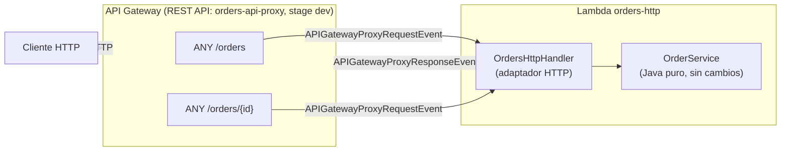

### Configuración

**Lambda `orders-http`**

| Configuración | Valor |
|---|---|
| Runtime | Java 17 |
| Rol | `LabRole` |
| Timeout | 15 s (el cold start ahora carga Jackson y las clases de eventos) |
| Handler | `com.workshop.orders.http.OrdersHttpHandler::handleRequest` |
| Artefacto | `target/orders-api-1.0.0.jar` (fat jar generado con `maven-shade-plugin`) |

**API Gateway `orders-api-proxy`**

| Recurso | Método | Integración |
|---|---|---|
| `/orders` | `ANY` | Lambda proxy → `orders-http` |
| `/orders/{id}` | `ANY` | Lambda proxy → `orders-http` |

Eso es **toda** la configuración: no hay mapping templates, method responses, integration responses, regex, modelos ni gateway responses.

**¿Por qué `ANY`?** Porque el enrutamiento por método HTTP vive en Java (`OrdersHttpHandler.route()`). Declarar `GET` y `POST` por separado en API Gateway duplicaría esa decisión en dos lugares. Con `ANY`, API Gateway solo conoce los recursos, y un método no soportado lo responde Java con **405 Method Not Allowed**.

### El evento de API Gateway

Se guardaron dos eventos reales capturados desde la consola de API Gateway (con los datos de la cuenta reemplazados por valores de ejemplo):

- [`events/apigw-proxy-event-get-order.json`](events/apigw-proxy-event-get-order.json)
- [`events/apigw-proxy-event-post-order.json`](events/apigw-proxy-event-post-order.json)
  Dónde aparece cada dato:

| Dato | Campo del evento | Ejemplo |
|---|---|---|
| Método HTTP | `httpMethod` | `"GET"` |
| Path real | `path` | `"/orders/ORD-001"` |
| Path como plantilla | `resource` | `"/orders/{id}"` |
| Path parameters | `pathParameters` | `{"id": "ORD-001"}` |
| Query parameters | `queryStringParameters` (y `multiValueQueryStringParameters`) | `{"customerId": "CUST-42"}` |
| Headers | `headers` (y `multiValueHeaders`) | `{"Content-Type": "application/json"}` |
| Body | `body` | `"{ \"customerId\": \"CUST-42\", ... }"` |
| Metadatos | `requestContext` | stage, requestId, identidad del llamante, etc. |

Observaciones:

- **El `body` llega como string**, no como objeto JSON. API Gateway no lo interpreta, así que el adaptador debe deserializarlo con `JSON.readValue(body, CreateOrderRequest.class)`.
- **`path` vs `resource`.** El adaptador enruta con `resource` (`/orders/{id}`) y obtiene el id de `pathParameters`, sin parsear la URL a mano.
- **Los parámetros ausentes llegan como `null`**, no como mapas vacíos. Por ejemplo, `queryStringParameters` es `null` cuando no hay query string. El adaptador lo contempla en `param()`.
- **El evento contiene datos de identidad** del llamante (`accountId`, `userArn`, `accessKey`). Por eso se reemplazaron antes de guardarlos en el repositorio.
### El adaptador HTTP

`OrdersHttpHandler` (paquete `com.workshop.orders.http`) es la **única** clase que conoce HTTP. `OrderService`, `Order` y las excepciones de dominio no cambiaron.

| Responsabilidad | Arquitectura A (API Gateway) | Arquitectura B (adaptador Java) |
|---|---|---|
| Enrutamiento | Un método y una Lambda por operación | `route()` según `httpMethod` + `resource` |
| Extraer `{id}` | `$input.params('id')` en VTL | `event.getPathParameters().get("id")` |
| Extraer `customerId` | `$input.params('customerId')` en VTL | `event.getQueryStringParameters().get("customerId")` |
| Parsear el body | Runtime de Lambda | Jackson, en el adaptador |
| JSON inválido | Modelo + validador + gateway response | `catch (JsonProcessingException)` → 400 |
| 404 / 400 | Regex sobre el texto de `errorMessage` | `catch` por **tipo** de excepción |
| Error inesperado | Regex `INTERNAL_ERROR:.*` (si alguien la configuró) | `catch (Exception)` → siempre 500, sin detalles |
| Header `Location` | `$context.responseOverride` en VTL | `headers.put("Location", "/orders/" + id)` |
| Método no soportado | No contemplado | 405 `METHOD_NOT_ALLOWED` |

Ya no son necesarios los prefijos de texto (`ORDER_NOT_FOUND: ...`): el status code depende del **tipo** de la excepción, y eso lo verifica el compilador.

El adaptador recibe el `OrderService` por constructor. Lambda usa el constructor vacío (con el repositorio precargado) y los tests inyectan uno controlado.

### Pruebas unitarias del adaptador

`OrdersHttpHandlerTest` construye eventos `APIGatewayProxyRequestEvent` iguales a los que envía API Gateway y verifica la respuesta HTTP, **sin AWS**:

| Test | Verifica |
|---|---|
| `getExistingOrderReturns200` | 200 + `Content-Type: application/json` |
| `getMissingOrderReturns404WithErrorFormat` | 404 con el body exacto del contrato |
| `searchByCustomerReturns200` | 200 con una lista |
| `searchWithoutQueryStringReturns400` | 400 cuando `queryStringParameters` es `null` |
| `postValidOrderReturns201WithLocation` | 201 + `Location: /orders/ORD-004` |
| `createdOrderCanBeRetrievedAfterwards` | Una orden creada se puede consultar después |
| `postWithZeroQuantityReturns400` | 400 con el mensaje de la regla de negocio |
| `postWithTextQuantityReturns400` | 400 cuando un campo tiene tipo incorrecto |
| `postWithMalformedJsonReturns400` | 400 con JSON de sintaxis inválida |
| `postWithoutBodyReturns400` | 400 sin body |
| `unsupportedMethodReturns405` | 405 para métodos no soportados |
| `unexpectedErrorReturns500WithoutInternalDetails` | 500 genérico, sin filtrar el mensaje interno de la excepción |

Varios de estos tests cubren exactamente los problemas que en la Arquitectura A solo se descubrieron probando manualmente en AWS (hallazgos 1, 3 y 5).

Resultado de `mvn clean package`: **27 tests, 0 fallos**.

### Pruebas con curl

```powershell
$API2 = "https://plj90flkd8.execute-api.us-east-1.amazonaws.com/dev"
```

| Request | Status | Body |
|---|---|---|
| `GET /orders/ORD-001` | **200 OK** | `{"id":"ORD-001","customerId":"CUST-42","product":"MacBook Air","quantity":1}` |
| `GET /orders/ORD-999` | **404 Not Found** | `{"error":"ORDER_NOT_FOUND","message":"Order ORD-999 does not exist"}` |
| `GET /orders?customerId=CUST-42` | **200 OK** | `[{"id":"ORD-001",...},{"id":"ORD-002",...}]` |
| `GET /orders` | **400 Bad Request** | `{"error":"INVALID_REQUEST","message":"customerId is required"}` |
| `POST /orders` (válido) | **201 Created** + `Location: /orders/ORD-004` | `{"id":"ORD-004","customerId":"CUST-42","product":"MacBook Air","quantity":1}` |
| `POST /orders` (`quantity: 0`) | **400 Bad Request** | `{"error":"INVALID_REQUEST","message":"quantity must be greater than 0"}` |
| `POST /orders` (`quantity: "dos"`) | **400 Bad Request** | `{"error":"INVALID_REQUEST","message":"Request body is not valid JSON or has invalid field types"}` |
| `PUT /orders/ORD-001` | **405 Method Not Allowed** | `{"error":"METHOD_NOT_ALLOWED","message":"PUT /orders/{id} is not supported"}` |
| `GET /orders/ORD-004` (recién creada) | **200 OK** | `{"id":"ORD-004","customerId":"CUST-42","product":"MacBook Air","quantity":1}` |

Comandos:
```powershell
curl.exe -i "$API2/orders/ORD-001"
curl.exe -i "$API2/orders/ORD-999"
curl.exe -i "$API2/orders?customerId=CUST-42"
curl.exe -i "$API2/orders"
curl.exe -i -X POST "$API2/orders" -H "Content-Type: application/json" --data-binary "@requests/create-order.json"
curl.exe -i -X POST "$API2/orders" -H "Content-Type: application/json" --data-binary "@requests/create-order-invalid-quantity.json"
curl.exe -i -X POST "$API2/orders" -H "Content-Type: application/json" --data-binary "@requests/create-order-text-quantity.json"
curl.exe -i -X PUT "$API2/orders/ORD-001"
curl.exe -i "$API2/orders/ORD-004"
```

#### Evidencias

`GET /orders/{id}` a través de la integración proxy: API Gateway entrega el request sin transformarlo y el adaptador responde 200:

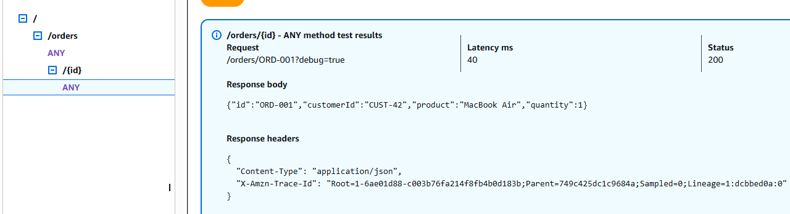

`POST /orders/{id}`: la combinación no existe en el contrato, y el adaptador Java responde **405 Method Not Allowed** (el enrutamiento por método vive en Java gracias a `ANY`):

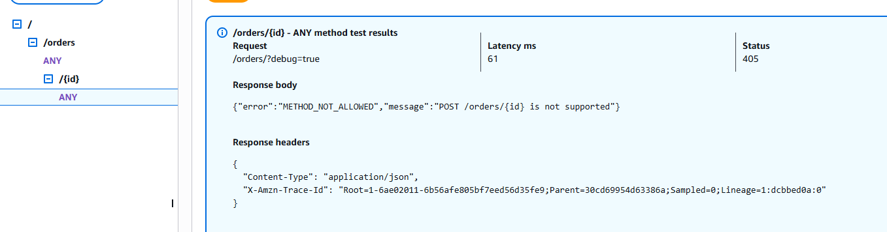

### Observaciones

**1. Todo funcionó en el primer despliegue.** Los casos que en la Arquitectura A requirieron varias rondas de corrección en la consola (tipo de dato inválido, query string ausente, error inesperado) ya estaban cubiertos por los tests antes de desplegar.

**2. Crear y luego consultar ahora funciona (201 → 200).** En la Arquitectura A, `POST` y `GET` corrían en Lambdas distintas con memorias separadas, y el mismo escenario daba **201 → 404**. Aquí las tres operaciones comparten la misma Lambda y, por lo tanto, el mismo repositorio en memoria.

> ⚠️ Esto **no** convierte la memoria en persistencia. Funciona porque las llamadas fueron secuenciales y las atendió el mismo entorno caliente. Con tráfico concurrente, Lambda crearía varios entornos, cada uno con su propia memoria, y el problema volvería a aparecer. Cuando AWS recicle el entorno, las órdenes creadas se perderán. Un almacenamiento compartido (por ejemplo DynamoDB) sigue siendo necesario.

**3. El JAR y el cold start crecieron.**

| | Arquitectura A (`orders-create`) | Arquitectura B (`orders-http`) |
|---|---|---|
| Tamaño del JAR | 19 KB (solo nuestras clases) | **3.4 MB** (+ AWS events + Jackson) |
| Billed duration en cold start | 348 ms | **1190 ms** |
| Memoria usada | 92 MB | **107 MB** |
| Timeout necesario | 3 s (por defecto) | Se subió a 15 s por precaución |

Este es el costo de mover la lógica HTTP a Java. La respuesta del Checkpoint 1 ("el JAR solo contiene nuestras clases") ya no es válida: ahora el JAR incluye dependencias de AWS.

**4. La serialización JSON pasó a ser responsabilidad nuestra.** En la Parte II, el runtime de Lambda convertía JSON ↔ Java automáticamente. Ahora la Lambda devuelve un `body` **string** que nosotros generamos con Jackson. Esto nos da control total (por ejemplo, decidimos ignorar campos desconocidos con `FAIL_ON_UNKNOWN_PROPERTIES = false`), pero también nos obliga a manejar los errores de parseo.

## 6. Comparación de arquitecturas

_Pendiente._

## 7. Desarrollo asistido por IA

_Pendiente._

## 8. Extensión: DELETE /orders/{id}

_Pendiente._

## 9. Arquitectura final

_Pendiente._

## 10. Cómo compilar y probar

### Requisitos

- JDK 17 o superior (el proyecto compila con `release 17`)
- Maven 3.9+
### Comandos

```bash
mvn test      # ejecuta las pruebas unitarias
mvn package   # genera target/orders-api-1.0.0.jar
```
