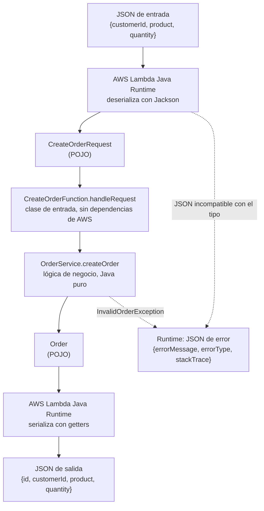

# Orders API — Serverless REST API con AWS Lambda y API Gateway

API REST de gestión de órdenes construida con **Java 17**, **Maven**, **AWS Lambda** y **Amazon API Gateway**.

El objetivo del taller no es solo obtener endpoints funcionando, sino analizar **dónde debe vivir cada responsabilidad**: en API Gateway, en el adaptador Lambda/HTTP o en la lógica de aplicación.
 
---

## Tabla de contenido

1. [Diseño de la API](#1-diseño-de-la-api)
2. [Parte I — Aplicación en Java puro](#2-parte-i--aplicación-en-java-puro)
3. [Parte II — Despliegue en AWS Lambda](#3-parte-ii--despliegue-en-aws-lambda)
4. [Parte III y IV — API Gateway con mapping templates](#4-parte-iii-y-iv--api-gateway-con-mapping-templates)
5. [Parte V — Lambda proxy integration](#5-parte-v--lambda-proxy-integration)
6. [Comparación de arquitecturas](#6-comparación-de-arquitecturas)
7. [Desarrollo asistido por IA](#7-desarrollo-asistido-por-ia)
8. [Extensión: DELETE /orders/{id}](#8-extensión-delete-ordersid)
9. [Arquitectura final](#9-arquitectura-final)
10. [Cómo compilar y probar](#10-cómo-compilar-y-probar)
---

## 1. Diseño de la API

### Modelo

```json
{
  "id": "ORD-001",
  "customerId": "CUST-42",
  "product": "MacBook Air",
  "quantity": 1
}
```

### Contrato

| Operación | Método y URL | Path params | Query params | Body de entrada | Éxito | Errores |
|---|---|---|---|---|---|---|
| Crear orden | `POST /orders` | — | — | `{customerId, product, quantity}` | **201 Created** + header `Location: /orders/{id}` + orden creada | **400** datos inválidos |
| Obtener orden | `GET /orders/{id}` | `id` | — | — | **200 OK** + orden | **404** no existe |
| Buscar por cliente | `GET /orders?customerId={customerId}` | — | `customerId` (obligatorio) | — | **200 OK** + lista de órdenes (puede ser `[]`) | **400** falta `customerId` |
| Eliminar orden | `DELETE /orders/{id}` | `id` | — | — | **204 No Content** (sin body) | **404** no existe |
| Cualquiera | — | — | — | — | — | **500** error inesperado |

### Formato de error

Todas las respuestas de error usan la misma estructura:

```json
{
  "error": "ORDER_NOT_FOUND",
  "message": "Order ORD-999 does not exist"
}
```

| Código `error` | HTTP | Cuándo |
|---|---|---|
| `INVALID_REQUEST` | 400 | Falta un campo obligatorio, `quantity <= 0`, body mal formado o falta `customerId` en la búsqueda |
| `ORDER_NOT_FOUND` | 404 | El `id` solicitado no existe |
| `INTERNAL_ERROR` | 500 | Cualquier error no previsto (sin exponer detalles internos) |

### Preguntas de diseño

**¿Cuáles son los recursos de la API?**
Hay un recurso principal, la orden, expuesto de dos formas: la **colección** de órdenes (`/orders`) y cada **orden individual** (`/orders/{id}`). Las operaciones se expresan con métodos HTTP sobre esos recursos, no con verbos en la URL (no existe `/createOrder` ni `/getOrder`).

**¿Por qué `/orders/{id}` para obtener una orden?**
Porque el `id` identifica de forma única a un recurso. La ruta se lee como "la orden `{id}` dentro de la colección de órdenes", y esa misma URL sirve para operar sobre ese recurso con otros métodos (`DELETE /orders/{id}`). Además, es la URL que se devuelve en el header `Location` al crear una orden.

**¿Por qué `customerId` es un query parameter en la búsqueda?**
Porque no identifica un recurso nuevo: **filtra** la colección `/orders`. El resultado sigue siendo una colección de órdenes. Los query parameters son la forma natural de expresar criterios de filtrado opcionales o combinables (por ejemplo, en el futuro `?customerId=CUST-42&product=Mouse`). Una ruta como `/customers/{id}/orders` también sería válida, pero implicaría modelar al cliente como recurso, lo cual no es necesario en este alcance.

**¿Qué debe devolver `POST /orders` cuando la orden se crea correctamente?**
`201 Created`, el body con la orden creada (incluyendo el `id` generado por el servidor) y el header `Location: /orders/{id}` indicando dónde quedó el nuevo recurso.

**¿Qué debe devolver la API cuando una orden no existe?**
`404 Not Found` con el JSON de error (`ORDER_NOT_FOUND`) y un mensaje que indique qué `id` no se encontró. No se debe responder `200` con body vacío ni `null`, porque el cliente no podría distinguir el error usando HTTP.

**¿Qué información debe contener una respuesta de error?**
- Un **código estable** (`error`) que un programa cliente pueda interpretar sin depender del texto.
- Un **mensaje legible** (`message`) para humanos que explique el problema.
- **No** debe contener stack traces, nombres de clases ni detalles internos de la infraestructura.
### Nota sobre persistencia

No se usa base de datos. Las órdenes se guardan en una colección en memoria (`InMemoryOrderRepository`), precargada con datos de ejemplo:

| id | customerId | product | quantity |
|---|---|---|---|
| ORD-001 | CUST-42 | MacBook Air | 1 |
| ORD-002 | CUST-42 | Mouse | 2 |
| ORD-003 | CUST-7 | Keyboard | 2 |

Los entornos de ejecución de Lambda son **efímeros**: la memoria se pierde cuando AWS recicla el entorno, y cada función Lambda tiene su propia memoria. Por eso una orden creada con `POST` puede no ser visible desde la Lambda que atiende `GET`. Los datos precargados permiten demostrar el comportamiento de lectura de forma predecible. En un sistema real, el repositorio en memoria se reemplazaría por una implementación persistente (por ejemplo DynamoDB) sin cambiar `OrderService`.
 
---

## 2. Parte I — Aplicación en Java puro

### Estructura

```
orders-api/
├── pom.xml
├── README.md
└── src/
    ├── main/java/com/workshop/orders/
    │   ├── domain/
    │   │   ├── Order.java
    │   │   ├── CreateOrderRequest.java
    │   │   ├── OrderNotFoundException.java
    │   │   └── InvalidOrderException.java
    │   └── application/
    │       ├── OrderRepository.java
    │       ├── InMemoryOrderRepository.java
    │       └── OrderService.java
    └── test/java/com/workshop/orders/application/
        └── OrderServiceTest.java
```

### Responsabilidades

| Clase | Responsabilidad |
|---|---|
| `Order`, `CreateOrderRequest` | Representan los conceptos del negocio |
| `OrderNotFoundException`, `InvalidOrderException` | Expresan fallos **de negocio** ("la orden no existe", "datos inválidos"), no códigos HTTP |
| `OrderRepository` | Abstracción del almacenamiento |
| `InMemoryOrderRepository` | Implementación en memoria del almacenamiento |
| `OrderService` | Reglas de negocio: validación, generación de ids, creación, consulta y búsqueda |

### Decisiones de diseño

- **La validación vive en `OrderService`.** Que una orden necesite cliente, producto y cantidad positiva es una regla de negocio: debe cumplirse sin importar si la petición llega por HTTP, por una invocación directa de Lambda o desde un test.
- **Los errores se modelan con excepciones de dominio.** La traducción a `400` o `404` es responsabilidad de una capa externa (API Gateway o el adaptador HTTP), no de la lógica de negocio.
- **Repositorio detrás de una interfaz.** Permite cambiar el almacenamiento en memoria por uno persistente sin tocar `OrderService`, y facilita las pruebas.
- **POJOs clásicos** (constructor vacío + getters/setters) en lugar de `record`, para que el serializador del runtime de Lambda pueda convertirlos desde y hacia JSON sin configuración adicional.
### Pruebas

`OrderServiceTest` cubre:

- creación de una orden válida;
- consulta de una orden existente;
- consulta de una orden inexistente (`OrderNotFoundException`);
- búsqueda de órdenes por cliente;
- búsqueda de un cliente sin órdenes (lista vacía);
- entradas inválidas: `customerId` nulo, `product` vacío, `quantity` en 0, request nulo y `customerId` vacío en la búsqueda.
  Resultado de `mvn test`:

```
Tests run: 10, Failures: 0, Errors: 0, Skipped: 0
BUILD SUCCESS
```

### Checkpoint 1

**¿Se puede probar la funcionalidad sin AWS?**
Sí. `mvn test` ejecuta todas las pruebas localmente, sin credenciales ni servicios de AWS.

**¿La aplicación requiere un servidor web?**
No. Es un conjunto de clases Java que se invocan directamente.

**¿Requiere Spring Boot?**
No. La única dependencia del proyecto es JUnit 5, y solo en `scope` de test.

**¿Qué contiene el JAR generado?**
Únicamente las clases compiladas del proyecto y los metadatos de Maven (`jar tf target/orders-api-1.0.0.jar`):

```
META-INF/MANIFEST.MF
com/workshop/orders/application/InMemoryOrderRepository.class
com/workshop/orders/application/OrderRepository.class
com/workshop/orders/application/OrderService.class
com/workshop/orders/domain/CreateOrderRequest.class
com/workshop/orders/domain/InvalidOrderException.class
com/workshop/orders/domain/Order.class
com/workshop/orders/domain/OrderNotFoundException.class
META-INF/maven/com.workshop/orders-api/pom.xml
META-INF/maven/com.workshop/orders-api/pom.properties
```

No incluye JUnit (dependencia de test), ni librerías de AWS, ni servidor web.

**¿Qué partes de la aplicación conocen HTTP?**
Ninguna. En este punto no existe ningún concepto de request, response, header ni status code en el código.
 
---

## 3. Parte II — Despliegue en AWS Lambda

### Función desplegada

Se desplegó la operación **crear orden** como la función Lambda `orders-create`.

| Configuración | Valor |
|---|---|
| Runtime | Java 17 |
| Arquitectura | x86_64 |
| Rol de ejecución | `LabRole` |
| Artefacto | `target/orders-api-1.0.0.jar` |
| Handler | `com.workshop.orders.lambda.CreateOrderFunction::handleRequest` |

No fue necesario rediseñar la aplicación. Se agregó una única clase de entrada, `CreateOrderFunction`, que construye el `OrderService` y le delega la operación:

```java
public class CreateOrderFunction {
 
    private static final OrderService SERVICE =
            new OrderService(InMemoryOrderRepository.withSampleData());
 
    public Order handleRequest(CreateOrderRequest request) {
        return SERVICE.createOrder(request);
    }
}
```

Esta clase **no depende de ninguna librería de AWS**: recibe un `CreateOrderRequest` y devuelve un `Order`. Existe solo porque el runtime de Lambda necesita instanciar la clase del handler con un constructor vacío, y `OrderService` recibe su repositorio por constructor. El JAR sigue sin dependencias externas, por lo que se sube tal cual.

### Invocaciones manuales

#### 1. Orden válida

**Request**
```json
{ "customerId": "CUST-42", "product": "MacBook Air", "quantity": 1 }
```

**Response**
```json
{ "id": "ORD-004", "customerId": "CUST-42", "product": "MacBook Air", "quantity": 1 }
```

El id es `ORD-004` porque el repositorio arranca con tres órdenes precargadas. Esta primera invocación mostró `Init duration: 308.90 ms`, que corresponde al *cold start*: el tiempo que tarda AWS en crear el entorno de ejecución y cargar la clase.


#### 2. Invocaciones repetidas: el id se incrementa

Al repetir la misma invocación, el id avanza (`ORD-005`, `ORD-006`, …) y ya no aparece `Init duration`.


Esto demuestra que, mientras el entorno está "caliente", Lambda **reutiliza** la misma instancia y por lo tanto los campos `static` (el `OrderService` y su repositorio en memoria) sobreviven entre invocaciones. Cuando AWS recicla el entorno, el estado se pierde y el contador vuelve a empezar. La memoria de Lambda sirve como caché, **no como almacenamiento persistente**.

#### 3. Otro cliente

**Request**
```json
{ "customerId": "CUST-100", "product": "Monitor", "quantity": 3 }
```

Respuesta exitosa con una nueva orden para `CUST-100`.


#### 4. Cantidad en cero → falla en la lógica de negocio

**Request**
```json
{ "customerId": "CUST-42", "product": "Mouse", "quantity": 0 }
```

La invocación **falla**. El JSON se convirtió correctamente a `CreateOrderRequest` y el código llegó a `OrderService`, que lanzó `InvalidOrderException`. El runtime transformó la excepción en un JSON de error con `errorMessage` (`quantity must be greater than 0`), `errorType` (`com.workshop.orders.domain.InvalidOrderException`) y `stackTrace`.


#### 5. Cantidad como texto → falla en el runtime, antes de llegar al código

**Request**
```json
{ "customerId": "CUST-42", "product": "Mouse", "quantity": "dos" }
```

La invocación **falla**, pero por una razón distinta: el runtime no pudo convertir `"dos"` en un `Integer` al deserializar el JSON. El error se produjo **antes** de ejecutar `handleRequest`, así que ninguna línea de la aplicación se ejecutó. Es un error de formato del mensaje, no de una regla de negocio.


#### 6. Campo desconocido → se ignora

**Request**
```json
{ "customerId": "CUST-42", "product": "Mouse", "quantity": 1, "color": "rojo" }
```

La invocación **tiene éxito**. `CreateOrderRequest` no tiene un campo `color`, y el serializador del runtime simplemente lo ignoró.


### Investigación: ¿cómo convierte el runtime de Lambda JSON ↔ Java?

**Explicación propuesta (con ayuda del LLM):**

1. Al crear el entorno, el runtime lee el handler configurado (`Clase::metodo`), carga la clase desde el JAR y la instancia con su **constructor vacío**.
2. Por **reflexión**, inspecciona el tipo del parámetro del método (`CreateOrderRequest`).
3. Usa un serializador JSON interno, basado en Jackson, para crear ese objeto: instancia la clase con el constructor vacío y asigna cada campo del JSON mediante el **setter** del mismo nombre.
4. Ejecuta el método.
5. Serializa el valor de retorno (`Order`) a JSON usando sus **getters**.
6. Si el método lanza una excepción, la convierte en un JSON con `errorMessage`, `errorType` y `stackTrace`, y marca la invocación como fallida.
7. Además de POJOs, el método puede recibir `String`, `Map` o un `InputStream` crudo (implementando `RequestStreamHandler`) cuando se quiere controlar la serialización manualmente.
   **Verificación contra el comportamiento observado:**

| Afirmación | Evidencia | ¿Se cumple? |
|---|---|---|
| JSON → POJO por nombre de campo | Prueba 1: los tres campos llegaron correctamente a `CreateOrderRequest` | ✅ |
| POJO → JSON con getters | Prueba 1: la respuesta contiene `id`, `customerId`, `product`, `quantity` | ✅ |
| La instancia se reutiliza entre invocaciones calientes | Prueba 2: el id se incrementa y desaparece el `Init duration` | ✅ |
| Las excepciones de la aplicación se convierten en JSON de error | Prueba 4: `errorType` es nuestra `InvalidOrderException` | ✅ |
| Un JSON incompatible con el tipo falla antes de ejecutar el código | Prueba 5: el error viene del parseo, no de `OrderService` | ✅ |
| Las propiedades desconocidas se ignoran | Prueba 6: `color` no produjo error | ✅ |

**Conclusión:** la conversión JSON ↔ Java es responsabilidad del **runtime de Lambda**, no de nuestro código. Por eso la aplicación puede trabajar solo con objetos de dominio. La contrapartida es que perdemos control sobre los errores de formato (prueba 5) y que todas las fallas se reportan con el mismo formato genérico de Lambda, no con el formato de error que diseñamos para la API. Ese problema se resolverá cuando agreguemos la capa HTTP.

### Checkpoint 2 — Diagrama de la solución



## 4. Parte III y IV — API Gateway con mapping templates

_Pendiente._

## 5. Parte V — Lambda proxy integration

_Pendiente._

## 6. Comparación de arquitecturas

_Pendiente._

## 7. Desarrollo asistido por IA

_Pendiente._

## 8. Extensión: DELETE /orders/{id}

_Pendiente._

## 9. Arquitectura final

_Pendiente._

## 10. Cómo compilar y probar

### Requisitos

- JDK 17 o superior (el proyecto compila con `release 17`)
- Maven 3.9+
### Comandos

```bash
mvn test      # ejecuta las pruebas unitarias
mvn package   # genera target/orders-api-1.0.0.jar
```
 